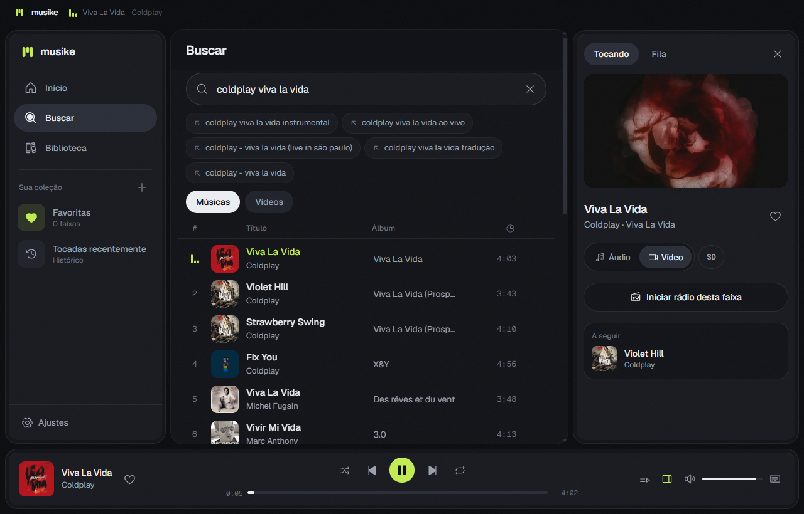
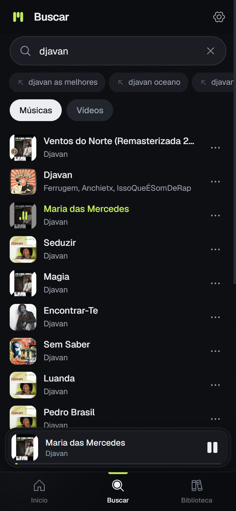
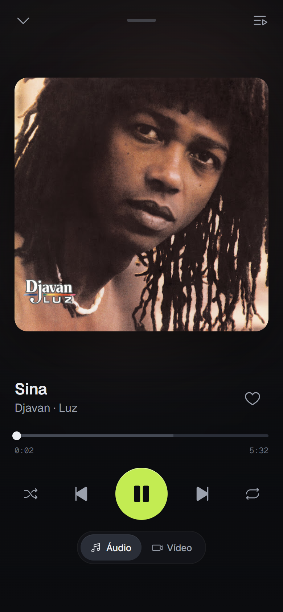
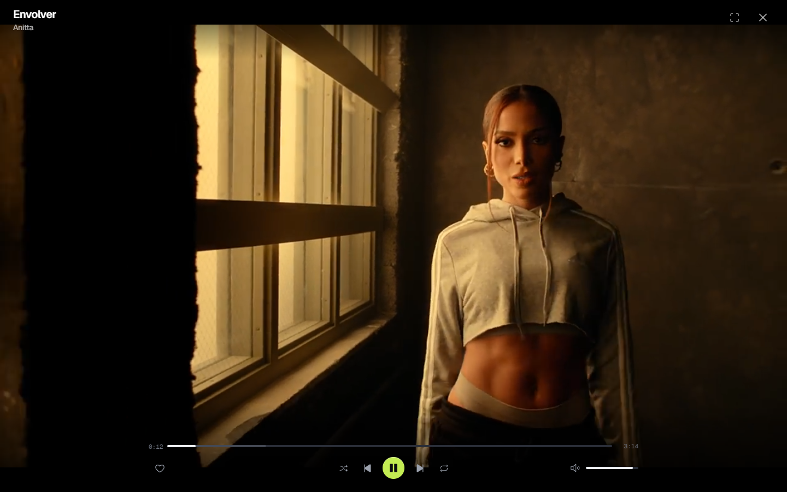
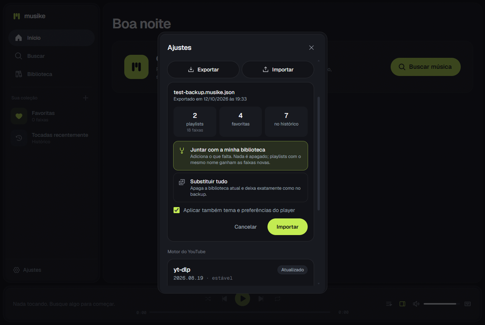
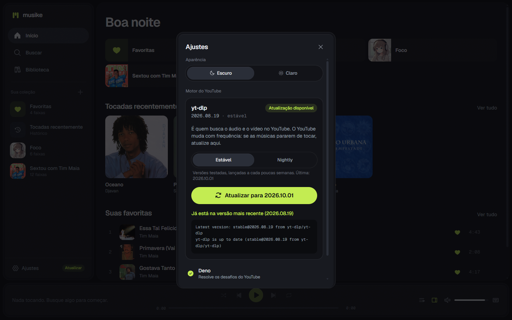
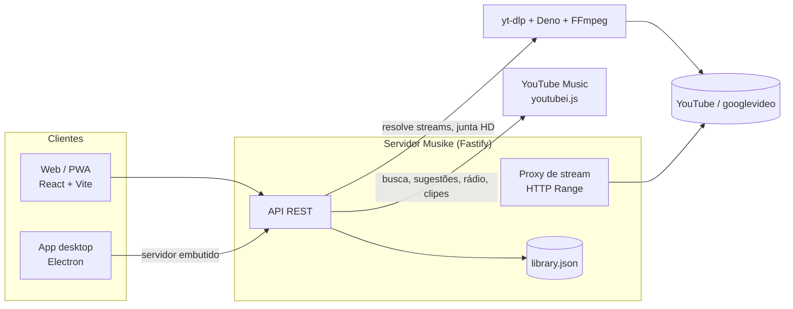

<div align="center">


# Musike

**Sua música, sem interrupção.**

Player pessoal que toca qualquer música ou clipe do YouTube, como **áudio** ou **vídeo**, sem anúncios.
Funciona no navegador, no celular (PWA) e como **app de computador** com instalador.




</div>

---

## Sumário

- [O que é](#o-que-é)
- [Recursos](#recursos)
- [Capturas de tela](#capturas-de-tela)
- [Como funciona](#como-funciona)
- [Instalação](#instalação)
- [Levar sua biblioteca para outra instância (backup)](#levar-sua-biblioteca-para-outra-instância-backup)
- [Atalhos de teclado](#atalhos-de-teclado)
- [Configuração](#configuração)
- [API](#api)
- [Estrutura do projeto](#estrutura-do-projeto)
- [Solução de problemas](#solução-de-problemas)
- [Roadmap](#roadmap)
- [Aviso legal](#aviso-legal)
- [Licença](#licença)

## O que é

O Musike nasceu da ideia dos antigos bots de música do Discord: um servidor que busca o áudio direto do YouTube e o entrega pronto para tocar. Em vez de um chat, a interface é um player completo, rápido e simples, com cara de app moderno e um toque gamer.

- **Sem anúncios e sem conta:** o servidor obtém o stream original com o [yt-dlp](https://github.com/yt-dlp/yt-dlp) e repassa os bytes ao player.
- **Música ou clipe:** troque entre Áudio e Vídeo a qualquer momento, do mesmo ponto da faixa. Para músicas, o Musike encontra o clipe oficial do artista.
- **Em qualquer tela:** layout pensado para celulares de todos os tamanhos, tablets, notebooks e monitores grandes.
- **Seu, de verdade:** roda no seu computador. Playlists e favoritas ficam num arquivo local que você pode exportar e levar para qualquer outra instância.

## Recursos

**Ouvir**
- Busca no YouTube Music com abas **Músicas** e **Vídeos** e sugestões enquanto você digita
- Cole um **link do YouTube** na busca para tocar direto
- Fila com tocar a seguir, aleatório e repetir (fila ou faixa)
- **Rádio automático:** quando a fila acaba, continua com músicas parecidas
- Avanço e retrocesso instantâneos (streaming com HTTP Range) e próxima faixa pré-carregada

**Vídeo**
- Modo Vídeo no painel lateral, na tela cheia do celular ou num mini player flutuante
- **Clipe oficial** encontrado automaticamente para faixas da aba Músicas (só aceita o canal do próprio artista)
- **Modo cinema:** maximize o clipe (botão, duplo clique ou tecla `F`), com controles que somem enquanto você assiste e tela cheia de verdade
- Qualidade SD (começa rápido) ou HD 720p (com cache local)

**Biblioteca**
- Playlists, Favoritas e histórico de tocadas recentemente
- **Backup em arquivo** para levar tudo a outra instância: juntar ou substituir, com prévia antes de importar

**Interface**
- Tema escuro e claro, layout responsivo do celular de 320 px ao monitor ultrawide
- Controles na tela de bloqueio, fones e teclas de mídia (Media Session)
- Retoma a fila e a posição de onde você parou
- Instalável como app no celular (PWA) e atalhos de teclado no computador

**App desktop (Windows)**
- Janela nativa com barra de título própria, sem navegador
- Instalador que cria o atalho na área de trabalho
- Baixa e mantém sozinho as ferramentas de que precisa (yt-dlp, Deno, FFmpeg)

**Manutenção**
- Tela **Ajustes** mostra a versão do yt-dlp, avisa quando há atualização e atualiza com um clique (canal Estável ou Nightly)
- Erros de reprodução oferecem o botão "Atualizar" direto no aviso

## Capturas de tela

<table>
  <tr>
    <td align="center"><br /><sub>Busca e mini player no celular</sub></td>
    <td align="center"><br /><sub>Tocando agora</sub></td>
  </tr>
</table>

<table>
  <tr>
    <td align="center"><br /><sub>Modo cinema</sub></td>
    <td align="center"><br /><sub>Importar backup com prévia</sub></td>
  </tr>
  <tr>
    <td align="center" colspan="2"><br /><sub>Atualização do yt-dlp em um clique</sub></td>
  </tr>
</table>

## Como funciona



1. **Busca:** o servidor consulta o YouTube Music com o [youtubei.js](https://github.com/LuanRT/YouTube.js) (busca, sugestões, rádio e escolha do clipe oficial).
2. **Reprodução:** o yt-dlp resolve as URLs do stream (áudio AAC, vídeo MP4). Essas URLs ficam presas ao IP de quem as resolveu, então o servidor faz o **proxy** dos bytes, repassando o cabeçalho `Range` para que o avanço seja instantâneo.
3. **Vídeo HD e clipes sem versão SD:** o yt-dlp baixa e junta vídeo + áudio com FFmpeg, guarda em cache (LRU, 2 GB por padrão) e o servidor entrega o arquivo com suporte a Range.
4. **Biblioteca:** playlists, favoritas e histórico ficam em `library.json`, gravado de forma atômica.
5. **Web:** um único elemento `<video>` é movido no DOM entre painel, tela cheia, mini player e modo cinema sem interromper a reprodução.

## Instalação

### Opção 1: app de computador (Windows)

Gere o instalador (ou baixe-o na página de Releases, se publicado):

```powershell
pnpm install
pnpm installer   # cria desktop\release\Musike-Setup-<versão>.exe
```

O instalador:

- instala só para o usuário atual (não pede administrador) e deixa escolher a pasta;
- cria o atalho **Musike** na área de trabalho e no Menu Iniciar e abre o app ao terminar;
- desinstala pelo Windows em Configurações > Aplicativos.

Na primeira abertura, uma tela mostra o download das ferramentas oficiais: **yt-dlp** e **Deno** (cerca de 60 MB) e, em segundo plano, **FFmpeg** (cerca de 80 MB, para vídeo HD). Tudo fica em `%APPDATA%\Musike`:

| Pasta | Conteúdo |
|---|---|
| `bin` | yt-dlp, Deno e FFmpeg do próprio Musike (atualizáveis em Ajustes) |
| `data` | `library.json` com playlists, favoritas e histórico |
| `cache` | vídeos HD já baixados |

> O instalador não é assinado digitalmente. Na primeira execução o Windows mostra "O Windows protegeu o computador": clique em **Mais informações** e depois **Executar assim mesmo**.

### Opção 2: servidor + navegador (computador e celular)

Requisitos:

| Ferramenta | Versão | Windows |
|---|---|---|
| Node.js | 22.19+ | `winget install OpenJS.NodeJS.LTS` |
| pnpm | 10+ | `npm install -g pnpm` |
| yt-dlp | recente | `winget install yt-dlp.yt-dlp` (instala Deno e FFmpeg junto) |

```powershell
pnpm install
pnpm build   # compila a interface
pnpm start   # http://localhost:4180
```

O servidor mostra os endereços de rede ao iniciar. Abra o endereço `Rede:` no celular conectado ao mesmo Wi-Fi (permita o Node no firewall em redes privadas). O servidor encontra o yt-dlp mesmo em terminais abertos antes da instalação, lendo o PATH do registro do Windows.

**Fora de casa:** instale o [Tailscale](https://tailscale.com) no computador e no celular. Para instalar como app (PWA) no celular, o navegador exige HTTPS: rode `tailscale serve --bg 4180` e use o endereço `https://...ts.net`.

> Não hospede em VPS ou nuvem: o YouTube bloqueia IPs de datacenter ("Sign in to confirm you're not a bot"). Rodar no seu computador usa seu IP residencial.

### Desenvolvimento

```powershell
pnpm dev        # servidor (4180) + Vite com recarga automática (5173)
pnpm desktop    # abre o app Electron em modo de desenvolvimento
pnpm typecheck  # checa os três pacotes
```

## Levar sua biblioteca para outra instância (backup)

Enquanto a sincronização em nuvem não existe, o Musike exporta tudo num arquivo que **qualquer instância** lê: web, desktop, outro computador.

1. Na instância de origem, abra **Ajustes > Seus dados > Exportar** (ou o ícone de banco de dados na Biblioteca). Um arquivo `musike-backup-AAAA-MM-DD.musike.json` é salvo.
2. Na instância de destino, **Ajustes > Seus dados > Importar** e escolha o arquivo.
3. Confira a prévia (quantas playlists, faixas, favoritas) e escolha:
   - **Juntar com a minha biblioteca** (padrão): adiciona o que falta e nunca apaga. Playlists com o mesmo nome ganham as faixas novas; importar duas vezes não duplica nada.
   - **Substituir tudo:** deixa a biblioteca exatamente como no backup (pede confirmação).
4. Opcionalmente, aplica também o tema e as preferências do player.

O arquivo é JSON legível e versionado:

```json
{
  "format": "musike-backup",
  "version": 1,
  "exportedAt": "2026-10-12T22:33:00.000Z",
  "app": "Musike 0.1.0",
  "library": {
    "favorites": [{ "id": "UpvruBhcH38", "title": "Oceano", "artist": "Djavan", "duration": 297, "thumb": "https://...", "art": "https://...", "kind": "song" }],
    "playlists": [{ "id": "…", "name": "Foco", "createdAt": 1791842422955, "updatedAt": 1791842422955, "tracks": [] }],
    "history": []
  },
  "settings": { "theme": "dark", "preferVideo": false, "quality": "sd", "autoRadio": true, "volume": 0.9 }
}
```

Na importação o servidor valida cada faixa (ID do YouTube, tamanhos, só imagens `https://`), descarta entradas inválidas em vez de recusar o arquivo inteiro e recusa backups de versões mais novas com uma mensagem clara.

## Atalhos de teclado

| Tecla | Ação |
|---|---|
| `Espaço` | Tocar / pausar |
| `←` `→` | Voltar / avançar 5 s |
| `Shift` + `←` `→` | Faixa anterior / próxima |
| `↑` `↓` | Volume |
| `M` | Mudo |
| `L` | Favoritar a faixa atual |
| `S` | Ordem aleatória |
| `R` | Repetir (desligado, fila, faixa) |
| `V` | Alternar Áudio / Vídeo |
| `F` | Modo cinema |
| `Q` | Fila |
| `/` | Buscar |
| `?` | Lista de atalhos |

## Configuração

Variáveis de ambiente do servidor (todas opcionais):

| Variável | Padrão | Uso |
|---|---|---|
| `PORT` | `4180` | Porta HTTP |
| `HOST` | `0.0.0.0` | Use `127.0.0.1` para aceitar só este computador |
| `YTDLP_PATH` | automático | Força um executável específico do yt-dlp |
| `YTDLP_EXTRA_ARGS` | | Flags extras, ex.: `--cookies-from-browser firefox` |
| `MUSIKE_DATA_DIR` | `server/data` | Onde fica `library.json` |
| `MUSIKE_CACHE_DIR` | `server/cache` | Vídeos HD baixados |
| `MUSIKE_CACHE_MAX_MB` | `2048` | Limite do cache de vídeo (apaga os menos tocados) |
| `MUSIKE_BIN_DIR` | | Pasta privada de ferramentas (o app desktop usa `%APPDATA%\Musike\bin`) |
| `MUSIKE_LANG` / `MUSIKE_LOCATION` | `pt` / `BR` | Idioma e região da busca |

## API

Todas as rotas respondem JSON. Erros vêm como `{ "error": "mensagem", "code"?: "tool_missing" | "maybe_outdated" | "bot_check" }`.

| Método | Rota | Descrição |
|---|---|---|
| `GET` | `/api/search?q=&type=song\|video` | Busca no YouTube Music |
| `GET` | `/api/suggest?q=` | Sugestões de busca |
| `GET` | `/api/radio/:id` | Faixas relacionadas (rádio) |
| `GET` | `/api/video-for/:id?title=&artist=&duration=` | Clipe oficial de uma música |
| `POST` | `/api/prepare/:id` | Resolve o stream antes de tocar |
| `GET` | `/api/stream/:id/audio` | Áudio com HTTP Range |
| `GET` | `/api/stream/:id/video?q=sd\|hd` | Vídeo com HTTP Range |
| `GET` | `/api/library` | Biblioteca completa |
| `PUT` / `DELETE` | `/api/favorites/:id` | Favoritar / desfavoritar |
| `POST` | `/api/history` | Registra uma faixa tocada |
| `POST` | `/api/playlists` | Cria playlist |
| `PATCH` / `DELETE` | `/api/playlists/:pid` | Renomeia / exclui |
| `POST` / `DELETE` | `/api/playlists/:pid/tracks[/:id]` | Adiciona / remove faixa |
| `POST` | `/api/library/import` | Importa backup (`{ backup, mode: "merge" \| "replace" }`) |
| `GET` | `/api/system` | Versões do yt-dlp, Deno, FFmpeg e downloads |
| `POST` | `/api/system/ytdlp` | Atualiza ou instala o yt-dlp (`{ channel: "stable" \| "nightly" }`) |

## Estrutura do projeto

```
musike/
├─ server/            Fastify + yt-dlp + youtubei.js
│  └─ src/
│     ├─ app.ts         rotas e inicialização (usado pelo CLI e pelo desktop)
│     ├─ ytdlp.ts       resolução de streams, cache HD, tradução de erros
│     ├─ stream.ts      proxy com HTTP Range
│     ├─ search.ts      busca, sugestões, rádio e escolha do clipe oficial
│     ├─ library.ts     playlists, favoritas, histórico e import de backup
│     ├─ tools.ts       localiza yt-dlp, Deno, FFmpeg (registro do Windows, winget)
│     ├─ bootstrap.ts   baixa as ferramentas para o app desktop
│     └─ system.ts      versão e atualização do yt-dlp
├─ web/               React 19 + Vite + Tailwind v4 + Motion + Phosphor (PWA)
│  └─ src/
│     ├─ player/        motor de reprodução (áudio, vídeo, fila, Media Session)
│     ├─ components/    player, painéis, modo cinema, Ajustes, backup
│     ├─ views/         Início, Buscar, Biblioteca, playlists
│     └─ stores/        estado (zustand)
├─ desktop/           Electron: janela, servidor embutido, instalador NSIS
└─ docs/              benchmark de UX, design system e capturas de tela
```

**Stack:** TypeScript em tudo · Fastify 5 · youtubei.js · yt-dlp · React 19 · Vite 8 · Tailwind CSS 4 · Motion · Zustand · React Router · Phosphor Icons · Geist · Electron 44 · electron-builder.

**Design:** a identidade (marca de equalizador em M, cor Volt, Geist) e as regras de layout estão em [docs/design-system.md](docs/design-system.md). O estudo de UX que guiou o layout está em [docs/ux-benchmark.md](docs/ux-benchmark.md): observação do web player do Spotify, sem descompilar código.

## Solução de problemas

**Parou de tocar ou "O YouTube recusou o stream"**
O YouTube muda com frequência e o yt-dlp acompanha. Abra **Ajustes** e toque em **Atualizar**. Se a correção ainda não chegou ao canal Estável, escolha **Nightly**.

**"O YouTube pediu verificação anti-bot"**
Passe cookies de um navegador logado (o Firefox funciona melhor no Windows):

```powershell
$env:YTDLP_EXTRA_ARGS = "--cookies-from-browser firefox"; pnpm start
```

**"yt-dlp não encontrado"**
No app desktop, use **Instalar** em Ajustes. No servidor, instale com `winget install yt-dlp.yt-dlp` ou defina `YTDLP_PATH`.

**O vídeo demora para começar**
Muitos vídeos não têm versão SD combinada; o servidor baixa e junta vídeo e áudio antes de tocar (alguns segundos na primeira vez, instantâneo depois, pelo cache).

**"Esta música não tem clipe no YouTube"**
O Musike só aceita clipes publicados pelo canal do próprio artista, para não tocar covers ou versões erradas. A música continua tocando em áudio.

**iPhone**
O iOS limita a reprodução em segundo plano de PWAs; o modo Áudio funciona melhor que o Vídeo.

## Roadmap

- [ ] Sincronização da biblioteca em nuvem (hoje: [backup em arquivo](#levar-sua-biblioteca-para-outra-instância-backup))
- [ ] Baixar faixas em MP3 / MP4
- [ ] Importar playlists do YouTube por link
- [ ] Instaladores para macOS e Linux
- [ ] Atualização automática do app desktop

## Aviso legal

O Musike é um projeto para **uso pessoal e educacional**. Reproduzir conteúdo do YouTube sem anúncios por extração de stream viola os [Termos de Serviço do YouTube](https://www.youtube.com/t/terms); serviços públicos que fizeram isso, como os bots Groovy e Rythm, foram encerrados após notificação do Google. Não publique o Musike como serviço, não o monetize e respeite os direitos dos artistas. O projeto não hospeda, distribui nem armazena conteúdo do YouTube além do cache local temporário de quem o executa.

## Licença

[MIT](LICENSE) © 2026 Ernani Neto
